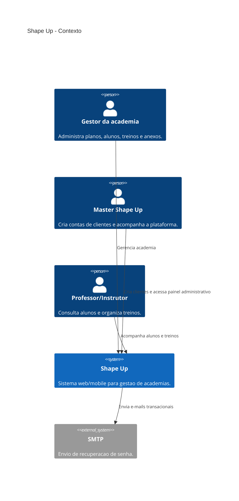
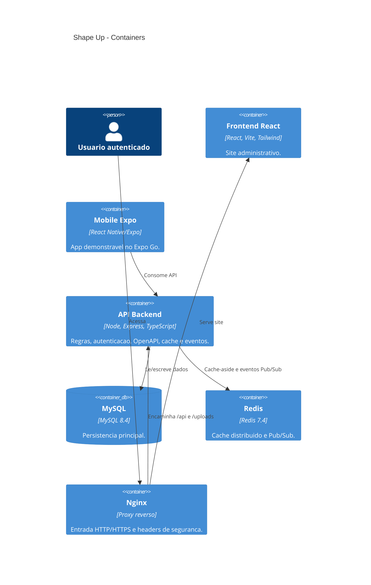
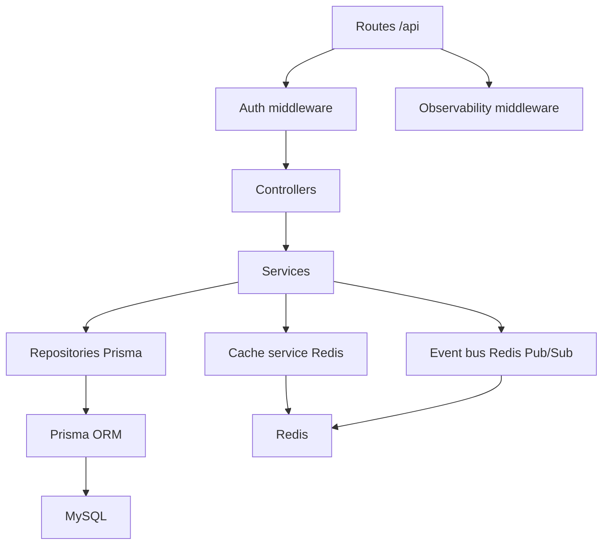

# Rubrica Nova 5 - Arquitetura, Back-end Avancado e Tech Forge

## Objetivo

Este documento registra a evolucao do Shape Up para a nova rubrica. A entrega
continua no projeto oficial `C:\Users\enzog\Desktop\ShapeUpNew`, sem criar
projeto paralelo.

## Mapa Rapido Da Rubrica

| Bloco | Criterio | Evidencia no projeto | Status |
| --- | --- | --- | --- |
| Arquitetura | Documentacao arquitetural com C4, ADRs e Quality Scenarios | Este documento, `docs/adrs/` e cenarios nesta revisao | Documentado; metricas pendentes |
| Arquitetura | Estilos arquiteturais e DDD | Context Map, Bounded Contexts e modelo tatico nesta revisao | Documentado |
| Arquitetura | Integracao, APIs e dados | `backend/src/docs/openapi.ts`, Swagger em `/api/docs`, ADR-0003, Prisma e MySQL | Implementado |
| Arquitetura | Qualidade, resiliencia e observabilidade | Middleware, SLOs/SLIs, retry, timeout, circuit breaker, fallback e logs | Implementado e documentado; medicao pendente |
| Arquitetura | Entrega continua | `.github/workflows/ci-cd.yml`, estrategia simples de deploy/rollback e `docs/runbook-incidentes.md` | Evidenciado; deploy remoto depende de secrets/servidor |
| Back-end Avancado | Redis cache-aside com TTL e invalidacao | `backend/src/services/cache-service.ts`, services de planos/alunos/treinos/painel | Implementado |
| Back-end Avancado | Redis Pub/Sub para eventos | `backend/src/services/event-bus-service.ts` | Implementado |
| Back-end Avancado | Docker Compose com Nginx | `docker-compose.yml`, `docker/nginx/shapeup.conf` | Implementado |
| Back-end Avancado | Boas praticas e observabilidade | Logs estruturados, request id, camadas, DTOs/schemas | Implementado |
| Tech Forge | Jira, Cynefin e ciclo de vida | Quadro SU real e Cynefin documentados; candidata 1.0.1 alinhada em Jira/manifests/changelog | Parcial ate a publicacao formal da versao parcial |

## C4 - Contexto



## C4 - Containers



## C4 - Componentes Do Backend



## Context Map E DDD

| Bounded Context | Responsabilidade | Entidades/Agregados | Evidencia |
| --- | --- | --- | --- |
| Identidade e Acesso | Login, JWT, master/admin, reset de senha | Usuario, token de recuperacao | `auth-service`, `user-repository` |
| Gestao Comercial | Planos da academia | Plano | `plan-service`, `/api/planos` |
| Gestao de Alunos | Cadastro, CPF/e-mail, vinculo com plano | Aluno | `student-service`, `/api/alunos` |
| Prescricao de Treinos | Treinos, objetivo, nivel e periodo | Treino | `workout-service`, `/api/treinos` |
| Operacao e Evidencias | Upload de anexos, validacao de arquivos | AnexoAcademia | `image-service`, `/api/imagens` |
| Inteligencia Operacional | Indicadores do painel | IndicadoresPainel | `dashboard-service`, `/api/painel/indicadores` |
| Infraestrutura Transversal | Cache, eventos, logs, OpenAPI | CacheEntry, EventoDominio, RequestLog | `cache-service`, `event-bus-service`, Swagger |

## Cache Distribuido Com Redis

Padrao aplicado: cache-aside.

Consultas cacheadas:

- `GET /api/painel/indicadores`;
- listagem de planos;
- listagem de alunos;
- listagem de treinos.

Politica:

- TTL padrao: `CACHE_TTL_SECONDS=60`;
- namespace padrao: `CACHE_NAMESPACE=shapeup`;
- chave sempre separada por `ownerId`, evitando vazamento entre academias;
- escritas em plano, aluno, treino e anexo invalidam `owner:{ownerId}:*`;
- se o Redis falhar, a API busca direto no MySQL e registra log `cache_*_falhou`.

## Mensageria E Eventos

Canal Redis Pub/Sub: `shapeup:eventos`.

Eventos publicados:

- `plano.criado`, `plano.atualizado`, `plano.removido`;
- `aluno.criado`, `aluno.atualizado`, `aluno.removido`;
- `treino.criado`, `treino.atualizado`, `treino.removido`;
- `anexo.registrado`, `anexo.removido`.

Evidencia em logs:

- `evento_publicado`: backend publicou no canal Redis;
- `evento_consumido`: assinante interno recebeu a mensagem via Pub/Sub;
- `evento_publicacao_falhou`: Redis indisponivel sem derrubar a API.

## SLOs, SLIs E Qualidade

| Objetivo | SLI | SLO inicial | Como observar |
| --- | --- | --- | --- |
| Disponibilidade local da API | Taxa de respostas 2xx/3xx em `/health` | 99% durante demonstracao | `docker ps`, `/health`, logs `http_request` |
| Latencia das consultas frequentes | `durationMs` em `http_request` | p95 abaixo de 500 ms em ambiente local | Logs estruturados |
| Cache saudavel | `cache_hit`, `cache_miss`, `cache_set` | Hits aparecem apos segunda leitura da mesma consulta | Logs da API |
| Eventos circulando | `evento_publicado` e `evento_consumido` | Cada escrita relevante gera ambos | Logs da API |
| Seguranca basica | Rotas protegidas recusam token ausente/invalido | 100% das rotas privadas protegidas | Testes Supertest/E2E |

## Estrategias De Resiliencia

- Redis opcional e tolerante a falha: cache/eventos nao bloqueiam operacao principal.
- Cache com TTL curto para reduzir risco de stale data.
- Invalidacao por dono da academia apos cada escrita.
- Nginx como ponto unico de entrada.
- MySQL em rede interna do Docker Compose.
- Upload valida extensao, MIME type, assinatura real e tamanho.
- Logs estruturados com `requestId` para rastrear incidentes.

## Plano Simples De Observabilidade

Logs coletados pela API:

- `http_request`: metodo, rota, status, duracao e request id;
- `cache_hit`, `cache_miss`, `cache_set`, `cache_invalidation`;
- `evento_publicado`, `evento_consumido`;
- `redis_conectado`, `redis_erro`, `redis_conexao_encerrada`;
- erros padronizados pelo middleware de erro.

Em uma evolucao futura, esses logs podem ser enviados para Grafana Loki,
Elastic ou CloudWatch. Para a rubrica, os logs locais ja comprovam rastreio dos
principais fluxos.

## Entrega Continua

O workflow executavel esta em `.github/workflows/ci-cd.yml`:

- pull requests: instala dependencias e executa lint, testes, build e validacao do Docker Compose;
- push para qualquer branch e pull request: executam validacoes; push para `main` tambem libera o deploy do commit validado por SSH;
- deploy remoto: exige os secrets `DEPLOY_HOST`, `DEPLOY_USER`, `DEPLOY_KEY`, `DEPLOY_KNOWN_HOSTS` e `DEPLOY_PATH` no GitHub;
- sem os secrets de destino, o workflow registra que o deploy foi ignorado; isso nao e uma implantacao concluida.

A estrategia de rollback simples e o runbook de incidentes estao em `docs/runbook-incidentes.md`. O host de deploy deve manter um clone limpo do repositorio, Docker Compose e o arquivo `.env` configurado fora do Git.
## Como Demonstrar A Nova Entrega

1. Subir a stack com `docker compose up -d --build`.
2. Acessar `http://127.0.0.1`.
3. Fazer login com seed.
4. Abrir painel duas vezes e observar `cache_miss` seguido de `cache_hit`.
5. Criar/editar plano, aluno ou treino e observar `cache_invalidation`.
6. Verificar logs `evento_publicado` e `evento_consumido`.
7. Abrir Swagger em `http://localhost/api/docs/`.

## Comandos De Evidencia

```powershell
docker compose ps
docker compose logs backend --tail=120
docker compose logs redis --tail=80
npm run lint --workspace backend
npm run build --workspace backend
npm run test --workspace backend
```


## Complemento da Rubrica de 23/11/2026

### Quality Scenarios

Os cenarios abaixo especificam estimulos, contexto, resposta esperada e medida. As metas sao objetivos iniciais; nao representam resultados de carga ja medidos.

| ID | Estimulo e contexto | Resposta esperada | Medida / evidencia |
| --- | --- | --- | --- |
| QS-01 Desempenho do painel | Usuario autenticado consulta GET /api/painel/indicadores duas vezes com Redis saudavel e cache aquecido. | A API retorna os mesmos indicadores autorizados para o ownerId e a segunda leitura usa o cache-aside. | SLO inicial: p95 abaixo de 500 ms em ambiente local. Medir durationMs em http_request e confirmar cache_hit; carga ainda nao aferida. |
| QS-02 Disponibilidade com falha de cache | Redis fica indisponivel enquanto backend e MySQL continuam saudaveis, durante consulta cacheada. | A API busca a fonte de verdade no MySQL e preserva a resposta do fluxo principal; eventos/cache registram falha sem derrubar a API. | Conferir resposta HTTP e logs cache_*_falhou / evento_publicacao_falhou; executar novamente na fase de validacao. |
| QS-03 Entrada HTTP e rastreio | Requisicao autenticada chega ao Nginx e atravessa a API em funcionamento normal. | A resposta e registrada com metodo, rota, status, duracao e requestId. | Conferir o evento http_request e correlacionar pelo requestId. |

### DDD Tatica - Contexto de Gestao de Alunos

O Context Map identifica Gestao de Alunos como um bounded context. O modelo conceitual abaixo torna explicitos os elementos pedidos na rubrica; no codigo atual eles sao representados pelo schema Prisma, validacoes compartilhadas e services, sem classes Value Object dedicadas.

| Tipo DDD | Elemento | Responsabilidade / regra | Representacao atual |
| --- | --- | --- | --- |
| Entity | Aluno | Identidade persistente, dados cadastrais e ciclo de vida do aluno dentro da academia. | Modelo Aluno em backend/prisma/schema.prisma e operacoes em student-service.ts. |
| Value Object | CPF | Valor cadastral normalizado e validado; identifica unicamente o aluno dentro do ownerId. | normalizeCpf/isValidCpf, campo cpf e constraint @@unique([ownerId, cpf]); sem classe propria. |
| Value Object | Email | Contato normalizado e validado; comparacoes usam o email canonico. | normalizeEmail/isValidEmail, campo email e constraint @@unique([ownerId, email]); sem classe propria. |
| Aggregate Root | Aluno | Ponto de entrada para cadastro e atualizacao dos dados do aluno; protege as regras de cadastro aplicadas pelo service. | student-service.ts coordena validacoes e persistencia via repository. |

A representacao DDD e documentada como modelo conceitual alinhado ao codigo existente. Uma futura extracao de classes de dominio deve ser feita em uma mudanca dedicada, sem criar uma camada paralela durante este fechamento.

### Resiliencia Aplicada e Limites

| Estrategia | Aplicacao observavel | Codigo/evidencia |
| --- | --- | --- |
| Retry com backoff limitado | Cliente Redis agenda novas tentativas com intervalo crescente e limite de 2 segundos; requisicoes Redis limitam retries por comando. | backend/src/lib/redis.ts: retryStrategy e maxRetriesPerRequest |
| Timeout | Espera de readiness do Redis termina em ate 3 segundos e retorna erro tratavel. | backend/src/lib/redis.ts: garantirRedisPronto |
| Fallback | Falha de cache permite seguir para o repositorio MySQL; falha de publicacao de evento e registrada sem interromper a operacao principal. | backend/src/services/cache-service.ts e backend/src/services/event-bus-service.ts |
| Healthchecks | Compose verifica disponibilidade do MySQL e Redis antes de iniciar dependentes. | docker-compose.yml |

Circuit breaker aplicado em `backend/src/lib/redis-circuit-breaker.ts`: abre apos tres falhas consecutivas do mesmo cliente, bloqueia novas operacoes por 10 segundos e permite uma sondagem em estado meio-aberto. Uma resposta bem-sucedida fecha o circuito. A leitura de cache recorre ao MySQL; escritas e eventos mantem o fluxo principal com logs de falha. Os eventos `redis_circuito_aberto`, `redis_circuito_meio_aberto` e `redis_circuito_fechado` permitem demonstrar as transicoes.

### Banco de Dados

A escolha de MySQL e Prisma esta registrada em docs/adrs/0003-mysql-com-prisma.md. O contrato OpenAPI existente continua em backend/src/docs/openapi.ts, servido por /api/docs e /api/openapi.json.

### Pipeline e Runbook

- Workflow de lint, teste, build, validacao do Compose e deploy condicional por SSH: .github/workflows/ci-cd.yml.
- Procedimento de triagem, recuperacao e rollback: docs/runbook-incidentes.md.
- O deploy precisa de um servidor remoto com os secrets DEPLOY_HOST, DEPLOY_USER, DEPLOY_KEY, DEPLOY_KNOWN_HOSTS e DEPLOY_PATH configurados no GitHub.
- Sem esses secrets, a etapa de deploy informa que foi ignorada; nao conta como implantacao executada.
